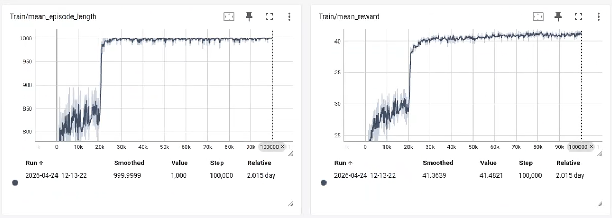

# AMP_mjlab

## Perceptive walking on rough terrain

The [published G1 policy](policies/sensor_transform/README.md) includes the original v3 checkpoint and its Unitree controller export. The [controller integration](deploy/unitree_rl_lab/README.md) covers the build, offline check and hardware camera input.

For installation, a short GPU run, and full training, see the [quick start](reproduce/QUICKSTART.md). The [reproduction handbook](reproduce/FRAMEWORK_REPRODUCTION.md) includes the training objective, exact dependencies, data checks, and the historical restoration procedure. New installations obtain the Hiking reference directly from the authors. Training with v3 also requires separately licensed motion files. [Motion setup](reproduce/QUICKSTART.md#hiking-reference-for-v4-and-v5)

Fresh runs use training version 5. It keeps the SuperMimic world model, returns the rest of the task to the original Hiking implementation (InstinctLab `de6b92f`) wherever MuJoCo allows, and adds three defaults for the physical robot: the camera sees vertical stair risers, collision uses a 2.5 cm grid, and each robot’s masses and joint dynamics are sampled around Unitree’s G1 (see [Real-robot deployment](#real-robot-deployment)). `--hiking-training-version 4` is the Hiking-aligned task without those three, `--hiking-training-version 3` the protocol before it, and existing checkpoints load the protocol they saved. [Hiking task source](https://github.com/project-instinct/InstinctLab/blob/de6b92f01eb155d51f30e8ed1ea7aecd2eb1f057/source/instinctlab/instinctlab/tasks/parkour/config/parkour_env_cfg.py)

- **Robot.** The **unshod G1** from Hiking’s `G1ParkourRoughEnvCfg`: the official torso-base URDF supplies collision geometry, axes and inertias, with Hiking’s delayed actuators (0–2 physics steps, sampled at reset). `--robot-variant shoe` selects Hiking’s registered task `Instinct-Parkour-Target-Amp-G1-v0` instead: soles 23 mm lower (collision capsules, foot volume points, foot-plane offset) and no actuator delay.
- **Task.** Hiking’s command distributions, ten terrain families and curriculum, 26 reward terms, terminations, material randomization, resets and eight-frame proprioceptive history. All 26 reward weights and formulas match the source.
- **Camera.** Hiking’s pinhole on its nominal torso mount: 64×36 rays, 89.51° × 58.29°, image-plane depth, hits within 0.1 m rejected per mesh. Each 50 Hz frame goes through Hiking’s 32×18 crop, 3×3 blur and 0–2.5 m normalization. The policy sees eight frames at a stride of five with a one-control-step delay. `--sensor-protocol g1_hiking_calibrated_v1` uses the [measured G1 RealSense intrinsics](src/assets/cameras/g1_depth_calibration.json) (88.92° × 58.11°) on the same mount, as version 3 did.
- **Footholds and terrain edges.** 100 volume points per foot and two downward height rays per foot, as in the source. Edge cylinders (radius 0.05 m) are detected on Hiking’s own terrain mesh, in which every rise steeper than 45° is a vertical face, rebuilt from the same height arrays and merged as Hiking’s terrain importer does. Version 3 detected them on the MuJoCo heightfield, where steps under about 0.14 m are ramps too shallow to count as edges.
- **AMP reference.** Hiking’s single trajectory from `parkour_motion_without_run.yaml`, played back per robot: start uniform in the first 90% of the clip, mirrored with probability 0.5. The discriminator trains on 24 collected control steps with five epochs and four minibatches per epoch. `--walking-expert-source pre_hiking_local_walk_turn_v2` adds the 13 local walking and turn clips of version 3. [Hiking source provenance and hashes](src/assets/motions/g1/hiking_official/SOURCE_MANIFEST.json)
- **Discriminator regularization.** The logit layer’s L2 coefficient is 1.0, the value Hiking’s trainer applies. Hiking’s config says 0.04, but `instinct_rl` looks the coefficient up under a name that does not exist and falls back to 1.0. `--discriminator-head-weight-decay 0.04` selects the configured value.

What still differs from Hiking is the simulator. In version 4, collision and depth images use a MuJoCo heightfield, so a vertical riser is a ramp across one 0.05 m cell. Version 5 narrows this (see [Real-robot deployment](#real-robot-deployment)): the camera sees Hiking’s vertical risers (`--depth-geometry source_mesh`) and the ramp the feet meet is halved (`--collision-horizontal-scale 0.025`). Contact solving, friction combination between robot links and restitution follow MuJoCo. Section 1.5 of the [reproduction handbook](reproduce/FRAMEWORK_REPRODUCTION.md) lists every difference and the checks behind the alignment.

Training uses SuperMimic’s GenCoord velocity prediction, analytic integration, 7-transition supervision and H32 imagination. Fresh defaults use 4096 environments, a 2048×3 world-model MLP, 10 WM batches of 2048, an actor batch of 4096 and 1000 vector steps of GPU Replay. The depth encoder learns from online reconstruction and the WM predicts the next 128-dimensional latent directly. GPU frame sharing, batched kinematics, compilation and CUDA Graphs remain available. [SuperMimic training loop](https://github.com/HybridRobotics/supermimic/blob/abc124c1bd5976341034668af3d12c087f2f1f55/src/supermimic/runners/supermimic_runner.py) · [InstinctMJ visual learner](https://github.com/project-instinct/InstinctMJ/tree/03563ee02665f327425106372264070315673748/src/instinct_mj/rl/supermimic)

```bash
python scripts/train_wmac_perceptive.py --run-name hiking_v5                       # for the physical robot, unshod
python scripts/train_wmac_perceptive.py --run-name hiking_v5_shoe --robot-variant shoe
python scripts/train_wmac_perceptive.py --run-name hiking_v4 --hiking-training-version 4   # Hiking-aligned only
python scripts/train_wmac_perceptive.py --run-name hiking_v3 --hiking-training-version 3
```

Add `--actor-type transformer` to a fresh run to compare Actor architectures. The latest proprioception and command form the action query over eight proprioception tokens, the single-camera depth latent, the current command and the readout token. The policy outputs 29 actions. Resume uses the Actor architecture recorded in the checkpoint.

## Training on two GPUs

One 48 GB card cannot hold the reference run of 4,096 robots: the simulator needs about 28 GB and the learner with its replay about 35 GB. `--sim-device` puts the simulator on a second card:

```bash
python scripts/train_wmac_perceptive.py --execution-profile supermimic --num-envs 4096 \
  --device cuda:0 --sim-device cuda:1 --iterations 1000000 --run-name hiking_v5_from_zero
```

- **What runs where.** Physics, depth rays and the environment's managers run on `--sim-device`. Networks, replay and imagination run on `--device`. Once per control step the observation, the depth frame and the transition (about 176 MB at 4,096 robots) cross from the simulator to the learner, and the action crosses back.
- **Same training.** Imagination needs the robot's kinematics, the reward terms and the terrain queries on the learner's card, so the learner works with its own copy of those constants ([`device_placement.py`](src/wmac/device_placement.py)). The copy reproduces the simulator-side functions exactly on one device and to float32 rounding across devices ([`test_device_placement.py`](tests/test_device_placement.py)). Without `--sim-device` nothing changes.
- **Placement is per machine.** It is not stored as part of the experiment: a resume or an evaluation uses the devices given on its own command line.
- **Expected memory, extrapolated.** Simulator card about 28 GB; learner card 33–41 GB (learner about 24 GB at the default actor batch of 4,096, plus about 10 GB of replay and per-robot history). If the learner card runs out, `--actor-microbatch-size 1024` splits the actor update: measured at 64 robots, the learner then needs about 10 GB instead of the estimated 25 GB, but each actor update takes 1.27 s instead of an estimated 0.5 s.
- **Transfer checks.** The default `--device-transfer host` stages cross-GPU training tensors through CPU memory. The trainer compares source and destination byte-sum checksums and retries a mismatch, with up to three attempts per tensor. At startup it tests both the direct and host routes. A failed direct comparison still allows training when the selected host route passes.
- **Verify a pair before training.** For example, in the activated project environment, run `CUDA_VISIBLE_DEVICES=2,3 python scripts/check_gpu_transfers.py --trials 60`. If the result lists logical GPUs 0 and 1 as usable, run `CUDA_VISIBLE_DEVICES=2,3 bash reproduce/smoke-local.sh --device cuda:0 --sim-device cuda:1 --device-transfer host`. Check the run's `runtime.json` for `completed: true`, a verified host route, a positive count of cross-GPU tensors, and zero checksum mismatches. The same visibility and device arguments apply to the full run above.
- **Local validation.** Training, CUDA Graphs, checkpointing, resume and export were exercised with a CPU simulator and GPU learner. Actual two-GPU operation and peak memory at 4,096 environments need validation on the training server.
- **More than two cards.** A run uses two. With four cards, start two runs (`--device cuda:0 --sim-device cuda:1` and `--device cuda:2 --sim-device cuda:3`), for example two seeds. Splitting one simulation across several cards is not implemented.

### Troubleshooting the first update on two GPUs

The v5 world model needs seven consecutive usable transitions in a single episode and the following state frame in replay. If the first batch contains no such sequence, the trainer continues collecting and retries on its normal update schedule. If the condition persists, the error reports counts of invalid transitions, episode terminations, timeouts and explicit replay cuts. These counts can overlap.

The optional diagnostic below starts with a direct GPU-to-GPU copy probe. Use it on a pair whose direct route passed. On a pair that requires the host route, use the transfer checker and ordinary smoke run above. The installer applies the mjlab CUDA stream fix on a fresh installation.

```bash
source reproduce/activate.sh
python reproduce/fix_mjlab_cuda_stream.py --apply
set -o pipefail
CUDA_VISIBLE_DEVICES=2,3 python reproduce/diagnose-hiking-smoke.py \
  --device cuda:0 --sim-device cuda:1 2>&1 | tee hiking-gpu23-trace.log
```

The trace compares the simulator and learner copies, counts eligible episode windows, and compares sampled actor observations against their original values. It synchronizes the cards for inspection. After a successful trace, use the ordinary 200-step smoke on the same pair to check asynchronous execution before the full run.

## Sim-to-sim in MuJoCo with Unitree's G1 model

The training robot is Hiking's torso-rooted G1. Unitree's MJCF and SDK follow a different convention, so a harness must convert between them. Use [`src/wmac_perceptive/unitree_interface.py`](src/wmac_perceptive/unitree_interface.py), which depends only on NumPy, together with the `deployment_contract.json` that every export now writes next to `policy.onnx`:

- **Waist joints have the opposite sign.** Hiking's URDF runs the waist from the torso to the pelvis, so `q_policy = −q_unitree` for waist yaw, roll and pitch. This applies to angles, velocities and targets. Joint order is otherwise identical.
- **Angular velocity and gravity are in the `torso_link` frame.** Do not use the pelvis IMU directly, and do not use Unitree's `secondary_imu` site, which sits on `waist_roll_link`. `torso_from_pelvis` derives the torso frame from the pelvis IMU and the waist encoders.
- **Camera mount.** On Unitree's G1 the camera is at `(0.0488, 0.01, 0.4278)` in `torso_link`. The Hiking torso frame sits 10 mm lower in the shell. Depth is image-plane depth divided by 2.5, and surfaces closer than 0.1 m along the ray are treated as misses.

The cost of each mismatch was measured with `sensor_transform.pt` in the training simulator: 512 robots, 10 s each, corrected contacts.

| Harness | Falls |
|---|---|
| Correct interface | 16.6% |
| Torso IMU from Unitree's `secondary_imu` | 68% |
| Pelvis IMU, or waist angles passed through unconverted | 100% |
| Unitree's masses and joint dynamics (`--robot-dynamics unitree_mujoco_g1_29dof`) | 23% |

```bash
python scripts/export_deployment.py --checkpoint /path/model.pt --output-dir deploy/   # ONNX + contract
python scripts/evaluate_wmac_perceptive.py --checkpoint /path/model.pt --device cuda:0 \
  --num-envs 512 --robot-dynamics unitree_mujoco_g1_29dof                             # Unitree dynamics
```

Training changes:

- **Heightfield contacts.** Unpatched MuJoCo-Warp 3.8.1 silently drops foot–terrain contacts. With correct contacts, `sensor_transform.pt` fails 82% of stair ascents instead of 61%. Training now refuses the unpatched library, and the installer applies the fix. `--allow-unpatched-hfield` reproduces the old physics.
- **Robot-dynamics randomization (default from training version 5).** `--robot-dynamics-randomization unitree_g1_v1` samples each environment's mass distribution and joint armature between the training robot and Unitree's model, 25% past each end. It also samples joint damping in 0–2× and friction loss in 0–1.5× of Unitree's values. Sampling happens once at startup, so it adds no per-iteration cost. The four sampled values are appended to the world-model and critic context; the actor never sees them. The option starts a new experiment, because the wider context changes the architecture.
- **Curriculum logging.** `metrics.csv` has a `terrain_level_<family>` column for each terrain family. Use them to check whether stair ascent (`pyramid_stairs_inv`) is advancing.

```bash
python scripts/train_wmac_perceptive.py --execution-profile supermimic --num-envs 4096 \
  --iterations 1000000 --run-name hiking_v5_from_zero            # includes the randomization
```

To test in unitree_rl_lab's `g1_ctrl`, export the checkpoint as a policy folder and the terrain tiles. For the controller patch and offline observation check, see the [Unitree integration guide](deploy/unitree_rl_lab/README.md).

```bash
python scripts/export_unitree_rl_lab.py --checkpoint /path/model.pt \
  --policy-dir ../unitree_rl_lab/deploy/robots/g1_29dof/config/policy/hiking/<name>
python scripts/export_sim2sim_terrains.py --output-dir ../unitree_rl_lab/deploy/robots/g1_29dof/sim2sim_hiking/terrains
```

In that sim-to-sim, Unitree's G1 MJCF models each foot as four 5 mm spheres, and on uneven ground the `sensor_transform.pt` policy falls in every run. With the training robot's seven sole capsules in their place (`--feet training`), the rough-terrain falls disappear. Foot collision geometry is not covered by `--robot-dynamics-randomization`.

In training versions 3 and 4 (architecture 9), `--iterations` counts **vector control steps**. The console reports learner updates as `iter` and shows cumulative `wall` time and average `sec_per_iter` every 50 updates by default. `--save-interval` counts learner updates and defaults to 1000. Checkpoints use `model_<iter>.pt`. `metrics.csv` records both `vector_step` and learner `iteration`. Earlier `model_step_<vector_step>.pt` checkpoints still use their saved protocol on resume or playback.

## Real-robot deployment

Three things separate a version 4 policy from the physical G1: the terrain it was trained on, the camera image it is fed, and where the camera is mounted.

**Train on vertical risers, with Unitree’s dynamics.** Training version 5 turns three options on; each remains a separate flag (`--depth-geometry collision`, `--collision-horizontal-scale 0.05`, `--robot-dynamics-randomization none` switch them off), and the first two also work on versions 3 and 4.

- `--depth-geometry source_mesh` adds Hiking’s own terrain mesh as geometry that only the depth camera sees. Risers are vertical, as on real stairs, instead of the heightfield’s ramps. In training, the camera’s terrain rays match MuJoCo’s reference rays on this mesh to within 6 µm.
- `--collision-horizontal-scale 0.025` samples the upper surface of that mesh on a 2.5 cm grid for collision. A MuJoCo heightfield cannot hold a vertical face, so the riser stays a ramp, but one cell is now 2.5 cm: a 15 cm riser is 80° instead of 72°, and the area where the feet’s surface departs from the seen surface by more than 1 cm halves. Edge cylinders and target patches are unchanged.

- `--robot-dynamics-randomization unitree_g1_v1` samples each robot’s mass distribution and joint armature, damping and friction loss around Unitree’s G1 model (details under “Training changes” above). The training robot is Hiking’s; with Unitree’s values alone, `sensor_transform.pt` falls in 23% of episodes instead of 16.6%.

Use the first two together, so that what the feet touch stays within one 2.5 cm cell of what the camera sees. Measured cost on an RTX 4080: 4% more time per training iteration (0.241 s against 0.232 s at 256 robots), about 1.1 GB more GPU memory, and 10 s more terrain generation. The first run also compiles simulator kernels for about 2.5 minutes. On the 2.5 cm grid MuJoCo-Warp prints `height field collision overflow` when a large body part lies on the ground (a fallen robot touches more than 50 grid prisms); the contact is still made and the robot terminates. Feet do not trigger it.

`--terrain-geometry real_robot` evaluates any Hiking checkpoint on this geometry. `sensor_transform.pt`, trained on the heightfield, is unaffected by it: 10.4% of episodes fall against 10.2% on its training geometry (512 robots, 10 s each).

**Convert the RealSense image.** The policy was trained on Hiking’s pinhole (principal point at the image centre). The G1’s depth stream at 480×270, 60 Hz has a different focal length and a principal point 5 pixels off centre ([stream calibration](src/assets/cameras/g1_depth_calibration_480x270_60hz.json)). `RealSenseDepthAdapter` in [`unitree_interface.py`](src/wmac_perceptive/unitree_interface.py) converts a raw Z16 image into the policy’s 64×36 frame:

- Each training pixel reads the RealSense pixel on its own ray. Both cameras share an optical centre, so this fixed lookup is exact and image-plane depth is unchanged. On a synthetic floor-and-step scene the result is within 3 mm of the training camera, against up to 11 mm for a plain resize.
- Pixels without a measurement, or nearer than 0.2 m, are filled from their neighbours inside the region the policy sees, as Hiking’s robot code does. The fill is a NumPy neighbour average, not Hiking’s `cv2.inpaint`.
- Convert the newest image once per 50 Hz control step. At 60 Hz every step has a new image.

```python
camera = RealSenseDepthAdapter()                 # G1 480x270 @ 60 Hz -> training camera
iface.step(..., depth_frame=camera.frame(raw_z16))
```

`export_deployment.py` also writes the lookup as `realsense_lookup.json` for a harness that is not Python.

**Camera mount.** No camera-to-torso measurement exists yet: the RealSense capture report contains only the factory depth-to-color transform. Training and the adapter therefore assume Hiking’s nominal mount. This matters more than the intrinsics: a camera pitched 3° away from nominal shifts the floor depth by 36 mm on average in the same synthetic scene. Once the orientation is measured, pass it as `RealSenseDepthAdapter(mount_rotation_wxyz=...)` or `--camera-mount-rotation`; the lookup then corrects a rotation exactly. It cannot correct a position offset.

```bash
python scripts/evaluate_wmac_perceptive.py --checkpoint /path/model.pt --device cuda:0 \
  --num-envs 512 --terrain-geometry real_robot                                       # vertical risers
python scripts/export_deployment.py --checkpoint /path/model.pt --output-dir deploy/   # + realsense_lookup.json
```

## Historical flat task

The `feature/robotics_yao` branch adds world-model AMP Actor-Critic training via
`scripts/train_wmac.py`, with policy playback, physical evaluation, benchmarks,
and ablations. For this flat task, `--profile supermimic` uses eight-step model
supervision, 32 imagined steps for the Actor and Critic, and the reference
training scale. The `balanced` profile keeps the same horizons with a smaller
network and batches.
The PPO-AMP training entry point remains `scripts/train.py`.

The new WMAC `ppo_aligned` profile and PPO task `Unitree-G1-AMP-Flat-Aligned`
share 203D AMP features with gravity, ground height and foot motion cues, plus
matched common parameters. The flat-task [training entry point](scripts/train_wmac.py)
handles explicit budget migration when resuming an older checkpoint.
WMAC retains UTD=0.4 and PPO retains 24-step rollouts; compare cumulative
resources at the same measured physical performance rather than outer iterations.

To play a trained flat-task policy in the browser, run:

```bash
python scripts/play_wmac.py --checkpoint /path/to/run/best_model.pt --mode recovery --viewer viser
```

Use `--viewer native` for a local window. The original development checkout also included integration, parameter-alignment, and performance reports covering the transition from PPO-AMP to WMAC, checkpoint selection, fixes, benchmarks, and runs with 4,096 environments.

Deployment integration code is in [ccrpRepo/wbc_fsm](https://github.com/ccrpRepo/wbc_fsm), under `MJAmp State`.

G1 AMP motion control project built on top of mjlab + rsl_rl.

Key features of the historical flat task:

- A single policy learns both locomotion (walk/run) and recovery (fall-and-get-up)
- AMP discriminator regularizes motion style and priors
- Training and deployment pipelines are consistent, with direct ONNX policy export support

## Core Idea

Instead of training separate policies for locomotion and recovery and switching between them, this project learns both capabilities in one unified policy.

Implementation highlights:

- Motion data split:
  - Walk/Run data: `src/assets/motions/g1/amp/WalkandRun`
  - Recovery data: `src/assets/motions/g1/amp/Recovery`
- Delayed termination/reset:
  - A subset of environments does not reset immediately after termination
  - These environments receive a recovery window and reset states sampled from recovery clips
- Unified AMP training:
  - One actor-critic + One AMP discriminator
  - Velocity tracking, perturbation robustness, and recovery are learned together

This reduces discontinuities caused by policy switching and yields more consistent behavior.

## Requirements

- Linux
- Python 3.11 (recommended)
- Working MuJoCo and GPU driver setup

## Environment used for flat-task training

The original training machine used the `yao-rl` Conda environment at `/home/autel/miniforge3/envs/yao-rl`, with Python 3.11, PyTorch 2.7.0+cu126, mjlab 1.2.0, mujoco-warp 3.8.1, and warp-lang 1.12.0. It had an editable project installation and the observation-manager patch shown below.

From that checkout, a new terminal could start training with:

```bash
cd /home/autel/AMP_mjlab_wmac
source scripts/activate_env.sh
python scripts/list_envs.py --keyword AMP
python scripts/train.py Unitree-G1-AMP-Flat --env.scene.num-envs 4096
```

On another machine with an existing environment, set `AMP_CONDA_ENV` to its name and optionally `AMP_CONDA_ROOT` to the Conda installation directory. The activation script checks the active Conda installation first, then common installation paths. It sets `MUJOCO_GL=egl` and prepends the checkout to `PYTHONPATH` so the AMP-enabled `rsl_rl` package loads locally. Keep the installed `rsl-rl-lib==5.0.1` distribution used by mjlab. The perceptive task's locked installation does this automatically.

To check flat-task PPO training with a short run, then view its TensorBoard logs:

```bash
python scripts/train.py Unitree-G1-AMP-Flat \
  --env.scene.num-envs 16 --agent.max-iterations 2 \
  --agent.num-steps-per-env 8 --agent.algorithm.num-learning-epochs 1 \
  --agent.run-name env_smoke
tensorboard --logdir logs/rsl_rl/g1_amp_locomotion --port 6006
```

TensorBoard is the default logger and requires no Weights & Biases account.

## Quick Start

### 1. Install

```bash
conda activate mjlab
cd AMP_mjlab
python -m pip install -e .
```

### 2. Apply mjlab Patch (Optional)

If you do not apply this patch, remove `history_ordering` configuration from the code.

What this patch does:

- It adds an option for how observation history is flattened: by time (`time`) or by term (`term`).
- Default mjlab behavior supports only `term` ordering.

Patch file:

- `mjlab_patch/mjlab/managers/observation_manager.py`

Example command:

```bash
cp mjlab_patch/mjlab/managers/observation_manager.py \
  /home/crp/miniconda3/envs/mjlab/lib/python3.11/site-packages/mjlab/managers/observation_manager.py
```

### 3. List Available Tasks

```bash
python scripts/list_envs.py --keyword AMP
```

Main tasks:

- `Unitree-G1-AMP-Rough`
- `Unitree-G1-AMP-Flat`

## Training

```bash
python scripts/train.py Unitree-G1-AMP-Flat --env.scene.num-envs=4096
```

Logs are saved by default to:

- `logs/rsl_rl/g1_amp_locomotion/<time_stamp_run>/`

## Training Curve Note (Important)

- Around `2w` iterations (about 20k), the policy often suddenly learns fall-recovery behavior.
- As a result, multiple metrics in `logs` may show abrupt jumps. This is expected and not necessarily a training failure.



## Evaluation and Visualization

Replay with a trained checkpoint:

```bash
python scripts/play.py Unitree-G1-AMP-Rough \
  --checkpoint-file logs/rsl_rl/g1_amp_locomotion/<run_dir>/model_<iter>.pt
```

Note: ONNX export is enabled by default in both training and play workflows.

## Motion Data Preparation

CSV-to-NPZ conversion script:

```bash
python scripts/csv_to_npz.py --help
```

Recommended data layout:

- Raw CSV: `motion_data_csv/amp`
- Converted NPZ: `src/assets/motions/g1/amp/WalkandRun` and `src/assets/motions/g1/amp/Recovery`

If valid NPZ files exist in these folders, training config loads them automatically.

## Repository Structure

- `src/tasks/amp_loco`: AMP locomotion/recovery task implementation
- `src/tasks/amp_loco/config/g1`: G1 task registration, env configs, RL configs
- `src/tasks/amp_loco/mdp`: rewards, observations, events, termination logic
- `scripts/train.py`: training entry point
- `scripts/play.py`: playback entry point
- `scripts/csv_to_npz.py`: motion data conversion tool
- `mjlab_patch`: required local patch for mjlab

## Highlights

- One policy unifies walk/run and recovery skills
- AMP + velocity objective jointly optimize style and task performance
- Delayed reset with recovery sampling explicitly improves recovery ability
- End-to-end pipeline supports ONNX export for deployment

## Acknowledgements

- Thanks to [unitreerobotics/unitree_rl_mjlab](https://github.com/unitreerobotics/unitree_rl_mjlab) for open-sourcing their work and inspiration.
- Thanks to [Open-X-Humanoid/TienKung-Lab](https://github.com/Open-X-Humanoid/TienKung-Lab); the rsl_rl AMP part in this project references their implementation.
