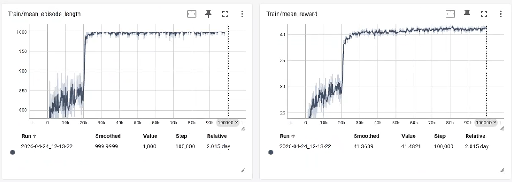

# AMP_mjlab

## 无鞋 G1 感知行走训练

默认训练使用 Hiking 普通无鞋 G1 配置 `G1ParkourRoughEnvCfg`，在 MuJoCo/mjlab 中运行。机器人碰撞体、关节和惯量来自官方无鞋 URDF，任务沿用 Hiking 的地形课程、速度指令、足底测点、延迟执行器、26 项奖励和 8 帧本体观测。材料接触、碰撞求解和高度场仍有 MuJoCo 与 PhysX 的实现差异。[Hiking 任务源码](https://github.com/project-instinct/InstinctLab/blob/de6b92f01eb155d51f30e8ed1ea7aecd2eb1f057/source/instinctlab/instinctlab/tasks/parkour/config/g1/g1_parkour_target_amp_cfg.py)

前向深度相机使用真机内参 `g1_hiking_calibrated_v1`，将 G1 的 848×480 深度流内参缩放到 64×36。相机仍使用 Hiking 标称安装位姿，仿真以 50 Hz 采集，64×36 裁到 32×18，模糊后将深度限制在 0–2.5 米并归一化。策略接收具有一个控制步延迟的 8 帧深度。当前关闭 RPL 遮挡和相机扰动，真机标定对应的深度流为 30 Hz。旧检查点按保存的相机协议加载。[真机标定](src/assets/cameras/g1_depth_calibration.json)

AMP 使用共享参考池，保留 Hiking 官方 YAML 选中的完整行走 NPZ，并恢复正式对齐 Hiking 前的 13 段本地行走和转向。原始片段及其镜像分别保留，从所有片段内的有效十帧窗口均匀采样。每收集 24 个控制步，以 5 遍、每遍 4 个逻辑小批训练判别器。新开训练时使用 `--walking-expert-source none` 可选择此前的纯 Hiking 参考时钟。[官方数据清单与哈希](src/assets/motions/g1/hiking_official/SOURCE_MANIFEST.json)

学习器保留 SuperMimic GenCoord 速度预测与解析积分，用 7 个转移监督 WM，并用 H32 想象训练策略。正式配置为 4096 个环境、2048×3 的 WM、每次 10 批各 2048、Actor 批量 4096、GPU Replay 长度 1000。视觉沿用 InstinctMJ 的在线重建与未来 128 维 latent 预测。单帧 Replay 共享、运动学复用、编译和 CUDA Graph 均可继续使用。[SuperMimic 训练源码](https://github.com/HybridRobotics/supermimic/blob/abc124c1bd5976341034668af3d12c087f2f1f55/src/supermimic/runners/supermimic_runner.py) · [InstinctMJ 视觉实现](https://github.com/project-instinct/InstinctMJ/tree/03563ee02665f327425106372264070315673748/src/instinct_mj/rl/supermimic)

```bash
python scripts/train_wmac_perceptive.py --run-name hiking_unshod
```

新开对照训练时可加 `--actor-type transformer`。该 Actor 用最新本体状态和指令生成动作查询，在 8 帧本体历史、单摄深度 latent、当前指令和读出 token 上做注意力，输出 29 维动作。普通续训按检查点记录的 Actor 架构加载。

新协议为训练版本 3、架构版本 9。**`--iterations` 表示并行环境的控制步数**。控制台和检查点使用同一个学习器更新计数 `iter`。默认每 50 轮打印累计耗时 `wall` 和平均秒/轮 `sec_per_iter`，每 1000 轮保存 `model_<轮次>.pt`。`--save-interval` 以学习器更新次数计数。`metrics.csv` 同时记录 `vector_step` 和 `iteration`。此前生成的 `model_step_<控制步>.pt` 可按其保存的协议播放和续训。

## 历史平地任务

`feature/robotics_yao` 分支新增方案③“世界模型主导 Actor-Critic”，训练入口为 `scripts/train_wmac.py`，完整流程和消融命令见 [WMAC 文档](docs/WMAC.md)。原版 PPO-AMP 入口 `scripts/train.py` 保留。

当前优化版支持 `--profile supermimic` 对齐 8 步模型监督、32 步 Actor/Critic 想象及参考训练规模；`balanced` 使用相同窗口和较小网络/批量。参数与兼容说明见 [参数对齐文档](docs/WMAC_OPTIMIZATION.md)，同精度 GPU 基准及验证记录见 [性能报告](docs/WMAC_PERFORMANCE.md)。

新增 `--profile ppo_aligned` 和 PPO 任务 `Unitree-G1-AMP-Flat-Aligned`，用共用的 203 维 AMP 特征补充重力、离地高度和脚底运动信息，并对齐两版可比较的参数。训练命令与保留的方法差异见 [AMP 可观测性修复与参数对齐](docs/AMP_GROUNDED_ALIGNMENT.md)。

两版保留各自训练节奏：WM 使用 UTD=0.4，PPO 每轮 rollout 24 步；按达到同等物理效果的累计时间与交互量比较。旧检查点续训的显式预算迁移命令也在上述文档中。

从原版 AMP 到世界模型训练的完整过程、旧策略选择、缺陷修复、性能实测及 4096 环境操作见 [完整报告（Markdown）](docs/AMP_SuperMimic_Integration_Report_zh.md) 和 [完整报告（PDF）](docs/AMP_SuperMimic_Integration_Report_zh.pdf)。

新版策略用 `python scripts/play_wmac.py --checkpoint /实际运行目录/best_model.pt --mode recovery --viewer viser` 在浏览器回放，或选择 `--viewer native` 打开本机窗口。回放及录像说明见 [WMAC 文档](docs/WMAC.md#可视化查看训练效果)。

[English README](README.md)

部署集成代码位于 [ccrpRepo/wbc_fsm](https://github.com/ccrpRepo/wbc_fsm) 项目中的 `MJAmp State`。

基于 mjlab + rsl_rl 的 G1 AMP 运动控制项目。

历史平地任务的核心特点是：

- 使用同一个 policy 同时学习 locomotion（走/跑）与 recovery（跌倒恢复）
- 通过 AMP 判别器约束动作风格与运动先验
- 在训练与导出链路中保持一致，支持直接导出 ONNX policy

## 核心思路

传统做法常把“走跑策略”和“恢复策略”分开训练并做切换；本项目将两类能力放入一个策略中统一学习。

实现要点：

- 运动数据分组：
	- Walk/Run 数据目录：`src/assets/motions/g1/amp/WalkandRun`
	- Recovery 数据目录：`src/assets/motions/g1/amp/Recovery`
- 延迟重置机制（Delayed Termination）：
	- 一部分环境在触发终止后不立即 reset，而是给定恢复窗口
	- 该子集环境优先从 Recovery 片段采样 reset 状态
- 统一 AMP 训练：
	- 单一 actor-critic + 单一 AMP discriminator
	- 在同一训练过程中学习速度跟踪、抗扰动与恢复能力

这样可以减少策略切换带来的状态不连续问题，得到更一致的行为。

## 环境要求

- Linux
- Python 3.11（建议）
- 已可用的 MuJoCo / GPU 驱动环境

## 本机训练环境（已配置）

本机复用 Conda 环境 `yao-rl`（`/home/autel/miniforge3/envs/yao-rl`），使用 Python 3.11、PyTorch 2.7.0+cu126、mjlab 1.2.0、mujoco-warp 3.8.1 和 warp-lang 1.12.0。项目已以可编辑模式安装，现有 mjlab 的观测管理器与仓库补丁一致。

每次打开新终端后，在项目目录执行：

```bash
cd /home/autel/AMP_mjlab_wmac
source scripts/activate_env.sh
python scripts/list_envs.py --keyword AMP
python scripts/train.py Unitree-G1-AMP-Flat --env.scene.num-envs 4096
```

激活脚本会选择已有环境、设置 `MUJOCO_GL=egl`，并将仓库根目录放到 `PYTHONPATH` 首位，以加载本仓库带 AMP 的 `rsl_rl`。本机无需再执行下方通用安装步骤中的 `pip install -e rsl_rl`；保留环境原有的 `rsl-rl-lib==5.0.1`，避免与 mjlab 的包依赖声明冲突。

其他机器可用 `AMP_CONDA_ENV` 指定已有环境名，用 `AMP_CONDA_ROOT` 指定 Conda 安装目录；未指定目录时，脚本优先使用当前 Conda，再查找用户目录下的常见安装位置。

短训练验证（完成后自动退出）：

```bash
python scripts/train.py Unitree-G1-AMP-Flat \
  --env.scene.num-envs 16 --agent.max-iterations 2 \
  --agent.num-steps-per-env 8 --agent.algorithm.num-learning-epochs 1 \
  --agent.run-name env_smoke
```

默认使用 TensorBoard 记录日志，无需登录 WandB。查看训练曲线：

```bash
tensorboard --logdir logs/rsl_rl/g1_amp_locomotion --port 6006
```

## 快速开始

### 1. 安装仓库

```bash
conda activate mjlab
cd AMP_mjlab
python -m pip install -e .
cd rsl_rl
python -m pip install -e .
```

### 2. 应用 mjlab 补丁（可选）

如果不打这个补丁，则需要在代码中去掉 `history_ordering` 配置。

补丁作用说明：

- 增加了历史观测的展开方式选项，可选择按时间维(`time`)或按观测项(`term`)展开。
- mjlab 默认仅支持按 `term` 展开。

补丁文件：

- `mjlab_patch/mjlab/managers/observation_manager.py`

示例覆盖命令：

```bash
cp mjlab_patch/mjlab/managers/observation_manager.py \
	/home/crp/miniconda3/envs/mjlab/lib/python3.11/site-packages/mjlab/managers/observation_manager.py
```

### 3. 查看可用任务

```bash
python scripts/list_envs.py --keyword AMP
```

主要任务：

- `Unitree-G1-AMP-Rough`
- `Unitree-G1-AMP-Flat`

## 训练


```bash
python scripts/train.py Unitree-G1-AMP-Flat --env.scene.num-envs=4096
```


日志默认在：

- `logs/rsl_rl/g1_amp_locomotion/<time_stamp_run>/`

## 训练曲线说明（重要）

- 在约 `2w` 轮（约 20k iterations）附近，策略通常会突然学会“跌倒后恢复”行为。
- 对应地，`logs` 中多个指标会出现明显突变（阶跃式变化），这是正常现象，不一定是训练异常。



## 评估与可视化

使用已训练权重回放：

```bash
python scripts/play.py Unitree-G1-AMP-Rough \
	--checkpoint-file logs/rsl_rl/g1_amp_locomotion/<run_dir>/model_<iter>.pt 
```

说明：训练与回放阶段都支持 ONNX 导出（默认开启）。

## 运动数据准备

仓库提供 CSV 到 NPZ 的转换脚本：

```bash
python scripts/csv_to_npz.py --help
```

推荐目录组织：

- 原始 CSV：`motion_data_csv/amp`
- 转换后 NPZ：`src/assets/motions/g1/amp/WalkandRun` 与 `src/assets/motions/g1/amp/Recovery`

只要上述目录中存在可用 NPZ，训练配置会自动加载。

## 目录说明

- `src/tasks/amp_loco`：AMP locomotion/recovery 任务实现
- `src/tasks/amp_loco/config/g1`：G1 任务注册、环境与 RL 配置
- `src/tasks/amp_loco/mdp`：奖励、观测、事件、终止逻辑
- `scripts/train.py`：训练入口
- `scripts/play.py`：回放入口
- `scripts/csv_to_npz.py`：动作数据转换工具
- `mjlab_patch`：依赖的 mjlab 本地补丁

## 项目亮点总结

- 单一策略统一覆盖走跑与跌倒恢复
- AMP + 速度任务联合优化，兼顾风格与任务性能
- 延迟重置与 recovery 采样机制，显式强化恢复能力
- 训练到部署链路完整，支持 ONNX 导出

## 致谢

- 感谢 [unitreerobotics/unitree_rl_mjlab](https://github.com/unitreerobotics/unitree_rl_mjlab) 项目的开源工作与启发。
- 感谢 [Open-X-Humanoid/TienKung-Lab](https://github.com/Open-X-Humanoid/TienKung-Lab)，本项目在 rsl_rl 的 AMP 部分参考了该实现。
